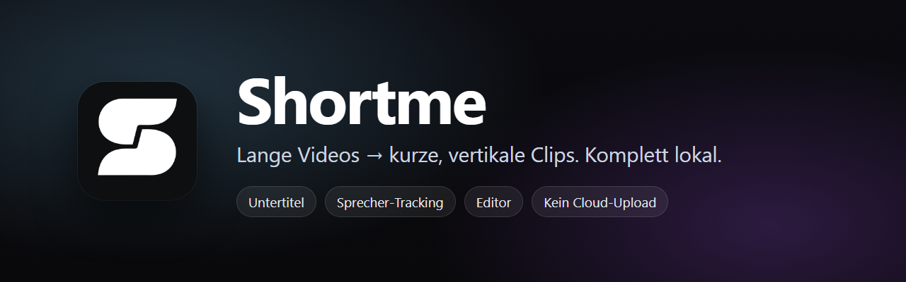
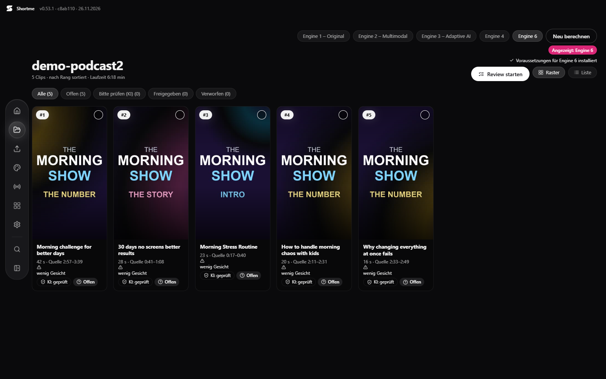
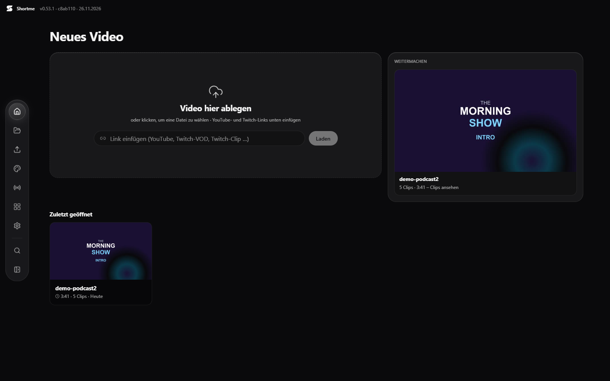
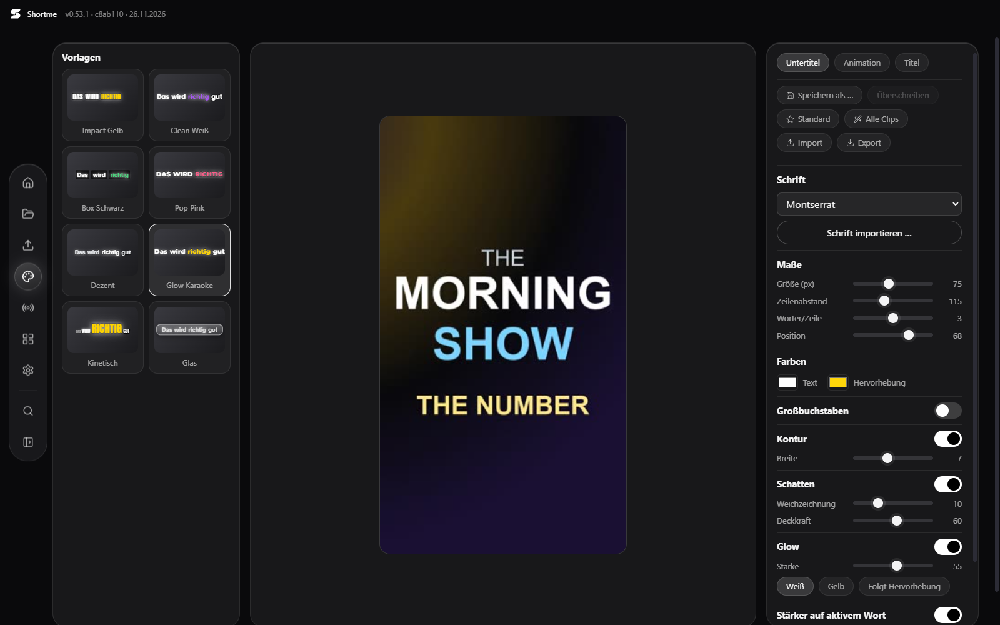

<p align="center">
  
</p>

<p align="center">
  <a href="https://github.com/Andirectly/shortme/releases/latest"></a>
  
  
  
  <a href="LICENSE"></a>
</p>

<p align="center">
  <b>Podcasts, Interviews, Vlogs und Streams → fertige Shorts für TikTok, Reels und YouTube Shorts.</b><br/>
  Die KI sucht die besten Momente, schneidet an Satzgrenzen, setzt animierte Untertitel und prüft jeden Clip,<br/>
  bevor du ihn siehst. Alles läuft auf deinem Rechner – ohne Cloud, ohne Abo, ohne Wasserzeichen.
</p>

<p align="center">
  <a href="https://github.com/Andirectly/shortme/releases/latest"><b>⬇ Download</b></a> &nbsp;·&nbsp;
  <a href="#so-funktioniert-es">So funktioniert es</a> &nbsp;·&nbsp;
  <a href="#engines">Engines</a> &nbsp;·&nbsp;
  <a href="#entwicklung">Entwicklung</a> &nbsp;·&nbsp;
  <a href="CHANGELOG.md">Änderungen</a>
</p>

<br/>

<p align="center">
  
</p>

---

## Was Shortme kann

| | |
|---|---|
| 🎯 **Momente finden** | Durchsucht das ganze Video über Sprache, Ton, Bild und (optional) Twitch-Chat und ordnet die Kandidaten nach ihrem vollständigen Wortlaut. |
| ✂️ **Sauber schneiden** | Schnitte nur an Satz-, Pausen- und Bildkanten. Kein abgehackter Satz, keine verlorene Pointe. |
| 💬 **Animierte Untertitel** | Wort für Wort mit Hervorhebung, eigene Stile und Vorlagen (Stil-Studio), Titel-Einblendung und optionaler Cold Opener. |
| 🎥 **Smarter Bildausschnitt** | Folgt dem Sprecher, wechselt bei Sprecherwechsel, nutzt Split-Layouts und findet Facecams in Streams. |
| ✅ **Geprüft, nicht geraten** | Jeder Clip wird als fertige Datei angesehen und angehört (Technik, Bild/Ton, Inhalt) – der Export übernimmt genau diese Datei. |
| 🏷️ **Nur Untertitel** | Fertiges Short ohne Untertitel? Ablegen, „Nur Untertitel“ wählen – das Video bleibt unverändert (kein Schnitt), Shortme transkribiert und brennt Untertitel ein. |
| 🛠️ **Voller Editor** | Wörter und Pausen schneiden, Layout korrigieren, Stil ändern – alles nicht-destruktiv mit Undo/Redo. |
| 📡 **Live & Links** | YouTube- und Twitch-Links laden, laufende Streams mitschneiden („letzte 3 Minuten sichern“). |
| 🖥️ **Auf anderem Rechner rechnen** | Mac und Windows-PC koppeln und das schwere Video auf dem stärkeren Gerät verarbeiten (Peer-to-Peer, verschlüsselt). |

<p align="center">
  
  
</p>

## So funktioniert es

1. **Video ablegen** oder YouTube-/Twitch-Link einfügen.
2. **Transkribieren** (lokal, mit Wortzeiten) und **Clips finden** – mit der Engine deiner Wahl.
3. **Ansehen & freigeben**: Review mit Tastatur (`1` freigeben, `2` prüfen, `3` verwerfen), bei Bedarf im Editor nachbessern.
4. **Exportieren** als fertiges 9:16-Video (1080×1920) mit eingebrannten Untertiteln.

## Engines

Shortme bringt mehrere Auswahl-Engines mit. Du wählst pro Projekt; Ergebnisse jeder Engine bleiben erhalten und lassen sich vergleichen.

| Engine | Plattform | Kurzbeschreibung |
|---|---|---|
| **Engine 1** | Windows | Liest Transkript und Ton-Markierungen. Am schnellsten, keine Zusatzmodelle. |
| **Engine 2** | Windows | Prüft Bild und Ton mit lokalen Modellen und vergleicht fertig geschnittene Varianten. |
| **Engine 3** | Windows | Durchsucht das ganze Video semantisch (Bild-Embeddings), dazu Ton und Text. |
| **Engine 4** | Windows | Vier unabhängige Suchwege, Nachuntersuchung mit Bild+Ton, Prüfung des gerenderten Clips mit Reparatur. |
| **Engine 6** | Windows | Redaktionelles Ranking über den vollen Wortlaut, nur offene Fragen werden in Bild und Ton nachgeprüft, die exportierte Datei wird in ganzer Länge geprüft. Im Test deutlich schneller als Engine 4; menschliche Qualitätsbewertung steht aus ([Details](docs/ENGINE_V6_BENCHMARK.md)). |
| **Engine Mac** | Apple Silicon | Qwen3.5 plant Schnitte, LFM3-Omni sieht und hört jeden Kandidaten, Apple-Tonanalyse. |

> Engine 6 ist optional und nicht Standard. Auf dem Mac ist sie bis zu einem Mac-Test ausgeblendet.

## Download

**[Neueste Version laden](https://github.com/Andirectly/shortme/releases/latest)**

| System | Datei | Voraussetzung |
|---|---|---|
| Windows 10/11 | `Shortme-Setup-<Version>.exe` | NVIDIA-GPU: Engine 1 ab 12 GB VRAM; Engine 2–4 und 6 nutzen Modelle mit bis zu ~22 GB (getestet auf RTX 5090 mit 32 GB) |
| macOS | `Shortme-<Version>-arm64.dmg` | Apple Silicon, 16 GB Arbeitsspeicher |

- **Modelle** lädt die App selbst (Modell-Manager) – je nach Engine einige bis rund 40 GB. Sie liegen nie im Repository.
- **macOS**: Die App ist nur ad-hoc signiert. Beim ersten Start einmal per Rechtsklick › *Öffnen* bestätigen. Updates auf dem Mac öffnen den geprüften Installer (DMG); Shortme dann in „Programme“ ziehen.
- **Datenschutz**: Nach der Modellinstallation ist keine Internetverbindung nötig. Es werden keine Cloud-KI-Dienste genutzt; nur das Laden von Links und Updates greift auf das Netz zu.

## Technik

Electron + TypeScript + React (Vite), Zustand. Lokale Engines als Sidecar-Prozesse: Parakeet TDT (sherpa-onnx) für die Transkription, llama.cpp (`llama-server`) bzw. MLX für Textmodelle, ONNX Runtime für Gesichter/Sprecher/Szenen, FFmpeg für Schnitt und Export, `@tscaps/engine` für Untertitel. Vorschau und Export nutzen denselben Planungs- und Render-Code.

## Entwicklung

```bash
git clone https://github.com/Andirectly/shortme.git
cd shortme
npm install
npm run dev          # App starten
npm test             # Tests
npm run typecheck    # Typen prüfen
npm run lint         # Lint
npm run package      # Installer bauen (release/)
```

Releases entstehen über den GitHub-Workflow `release.yml` (Mac + Windows). Die Dokumentation liegt in [`docs/`](docs) – Einstieg: [`APP-UEBERSICHT.md`](docs/APP-UEBERSICHT.md), [Design](docs/DESIGN.md), [Engine 6](docs/ENGINE_V6_STATUS.md), [Remote-Geräte](docs/REMOTE_ENGINE.md).

## Hinweise

- Shortme ist ein **privates Projekt** ohne Support-Zusage; Issues und Pull Requests sind willkommen, aber es gibt keine Garantie auf Antwort.
- Basis ist ein Fork von **ClipForge/Cutawan** (JeremySNR, MIT). Übernommener Fremdcode ist im jeweiligen Dateikopf mit `// from: …` gekennzeichnet (derzeit: Apache-2.0-Teile von AlterSend für die Geräteübertragung). Es gilt die [MIT-Lizenz](LICENSE) für den eigenen Code; Lizenzen der Modelle und Drittprogramme gelten jeweils für sich (siehe `docs/CATALOG.md`).
- Nutze Shortme nur mit Videos, an denen du die Rechte hast.
